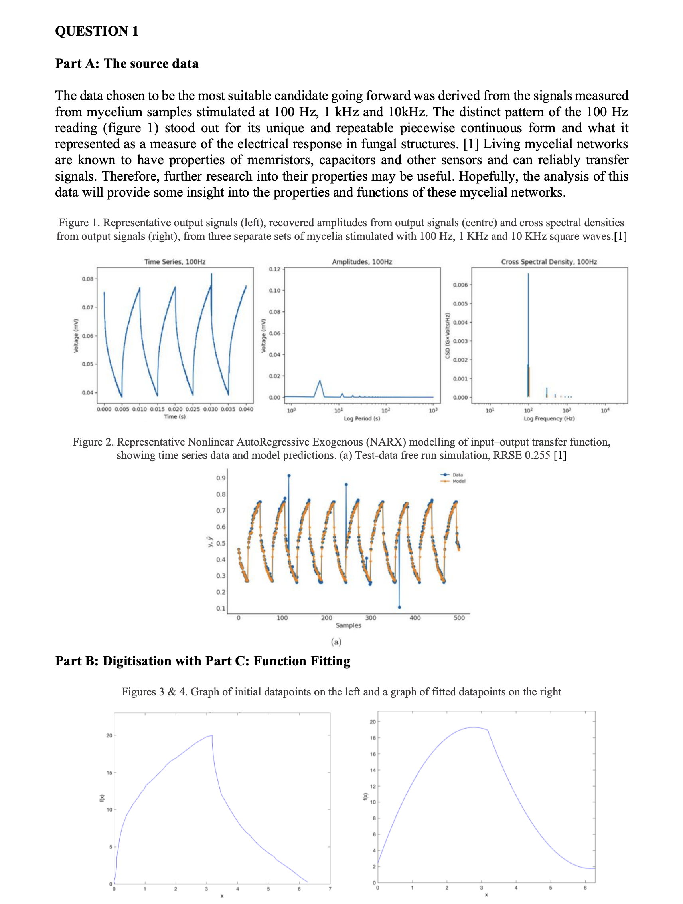
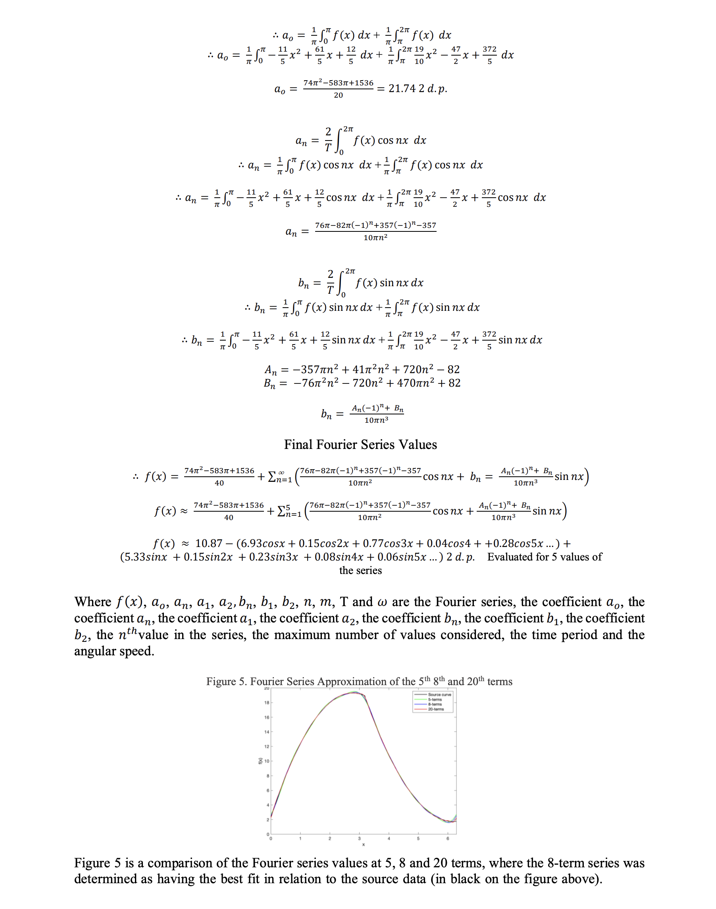

# MATLAB Modelling of Mycelial Impulses with the Fourier Series | DS 
 

Using Fourier series to model electrical impulses in mycelial networks and using statistics to determine goodness of fit in height datasets (provided).

